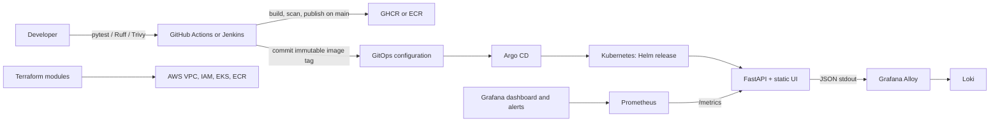

# Enterprise DevSecOps Platform Engineering Lab

A runnable platform-engineering portfolio lab: a small FastAPI service, hardened container, Helm deployment, CI examples, GitOps definitions, reusable AWS Terraform, and operations/observability assets. The local path is intentionally small; cloud, monitoring, and policy-controller integrations are opt-in.

> **Safety and cost:** Nothing in this repository runs `terraform apply`, accesses AWS, or provisions cloud resources. Review plans and cloud cost estimates with your organization before any deployment. EKS, NAT gateways, load balancers, logging, and persistent monitoring services incur ongoing charges.

## Architecture



The default local workflow does not start a Kubernetes cluster or observability stack. `docker compose up --build` runs only the application and binds it to loopback (`127.0.0.1:8000`). The workload requires no Kubernetes API permissions; its ServiceAccount token is not mounted. The separate diagnostics Role is opt-in.

## Prerequisites

- Python 3.12 and `make` for local tests and lint.
- Docker Engine with Compose v2 for container workflows.
- Helm 3.17+ for chart rendering and optional Kubernetes deployment.
- `kubectl` and a disposable local cluster only for cluster exercises.
- Terraform 1.10+ and AWS provider access only for infrastructure validation/planning.
- Trivy for security scans. `kubeconform` is optional for Kubernetes schema validation.

No global package installation is required. Python packages are installed in `.venv`.

## Local setup and verification

```bash
cd devops-platform-lab
cp .env.example .env            # Optional: values shown are non-secret examples
make install                    # Creates .venv and installs pinned app/test tools
make test
make lint
make build
make up
```

Open <http://127.0.0.1:8000/>. Verify API endpoints with `bash scripts/health-check.sh`. Stop with `make down`; this does not remove images or user data. `.env` is ignored by Git and must never contain production credentials.

`make security` runs a Trivy filesystem scan and fails on configured HIGH/CRITICAL findings. `make validate` runs tests, lint, Helm checks, Terraform formatting, and manifest rendering. Scanners need network access to refresh their vulnerability databases. The Docker image build needs registry access to fetch the pinned base image.

### Application API

| Endpoint | Purpose |
| --- | --- |
| `/` | Static health/status frontend |
| `/health` | Process liveness and uptime |
| `/ready` | Readiness; returns HTTP 503 when the safe dependency-failure switch is enabled |
| `/api/v1/info` | Non-sensitive build/environment information |
| `/metrics` | Prometheus counters, latency histogram, and in-progress gauge |

Configuration is environment-based. Important settings are `APP_NAME`, `APP_ENV`, `APP_VERSION`, `GIT_COMMIT`, `LOG_LEVEL`, `METRICS_ENABLED`, `SIMULATE_DEPENDENCY_FAILURE`, and `SIMULATE_SLOW_RESPONSE_MS`. Delay simulation is capped at 10 seconds. Do not enable simulations in shared or production environments.

## Repository walkthrough

| Path | Contents |
| --- | --- |
| `app/`, `tests/` | FastAPI service, static UI, unit/integration/security tests |
| `docker/`, `docker-compose.yml` | Multi-stage non-root image and loopback-only local service |
| `kubernetes/helm/` | Deployment, service, optional ingress/HPA/PDB/ExternalSecret and per-environment values |
| `kubernetes/policies/`, `kubernetes/rbac/` | Kyverno admission policy and optional namespace-scoped diagnostics reader |
| `gitops/argocd/` | Argo CD project and dev/staging/prod Applications |
| `jenkins/`, `.github/workflows/` | Jenkins declarative pipeline and GitHub Actions |
| `terraform/modules/`, `terraform/environments/` | VPC, IAM, EKS, ECR, add-ons and environment roots |
| `observability/` | Prometheus configuration/alerts, Grafana dashboard, Alloy and OTel examples |
| `scripts/`, `docs/` | Local deployment, validation, diagnostics, security and operations guides |

Helm is the supported Kubernetes packaging path. A parallel Kustomize tree was omitted to avoid maintaining two sources of truth for the same workload.

## Containers and security

The image pins Python 3.12.15 on Alpine 3.23 by digest, applies distribution updates at build time, separates dependency build from runtime, runs as UID/GID 10001, and includes a health check. Compose additionally uses read-only root, dropped capabilities, `no-new-privileges`, and a loopback-only port mapping. Container scanning is configured in both CI examples and `scripts/scan-security.sh`.

Kubernetes defaults include non-root execution, seccomp `RuntimeDefault`, read-only root filesystem, dropped capabilities, disabled privilege escalation, resource requests/limits, a tokenless ServiceAccount, NetworkPolicy, and immutable-style version tags. Kyverno policies are examples and must be installed/validated against the actual Kyverno version and cluster policy lifecycle before enforcement.

Secrets are not stored in values or manifests. The optional External Secrets template expects an installed External Secrets Operator and a preconfigured SecretStore/ClusterSecretStore; `values.yaml` leaves it disabled. CI credentials use Jenkins credential IDs or GitHub's short-lived `GITHUB_TOKEN`; never echo tokens. ECR uses immutable tags and scan-on-push. Prefer commit-SHA tags and registry-supported signatures/attestations for release provenance; digest pinning gives the strongest deployment immutability.

Threat considerations and integration boundaries are in [docs/security-model.md](docs/security-model.md).

## CI/CD and GitOps

Both pipelines run tests, lint, Trivy filesystem scans, image build/scan, and Helm/Terraform static checks. GitHub Actions publishes only from `main`, after a HIGH/CRITICAL image scan, using a commit-SHA tag, then updates the dev GitOps values and pushes that commit. Jenkins uses the `container-registry` credential ID for publishing and a configured Git username/password binding for dev promotion; optional SonarQube requires a configured Jenkins installation, `sonar-scanner`, and `SONARQUBE_ENVIRONMENT`.

Argo CD dev and staging sync automatically; production is manual-sync. Replace the example `ORG/REPOSITORY` source/repository strings before installation. Promotion changes only the environment's immutable `image.tag` in its values file, then requires review and a Git commit. Argo CD reconciles that commit; it does not build images. Promotion details and rollback options are in [docs/gitops-workflow.md](docs/gitops-workflow.md).

## Kubernetes and local deployment

Validate and render without a cluster:

```bash
helm lint kubernetes/helm/devsecops-platform -f kubernetes/helm/devsecops-platform/values-dev.yaml
helm template platform-demo kubernetes/helm/devsecops-platform \
  -f kubernetes/helm/devsecops-platform/values-dev.yaml
bash scripts/validate-manifests.sh
```

`make deploy-local` installs into the **current kubectl context**. Check `kubectl config current-context` first. Build the image and make it available to the selected local cluster (for example, load it into kind) before deployment. The Helm image repository defaults to an example registry; this target sets `platform-demo:local`.

Run `bash scripts/simulate-readiness-failure.sh` to start a separately named local container on `127.0.0.1:18001`, verify `/ready` returns 503, then stop only that container. It does not alter a Kubernetes workload.

## Observability and SRE

The app exposes Prometheus counters and histogram metrics and emits structured JSON to stdout. Prometheus scrape configuration, a ServiceMonitor example (Prometheus Operator CRD required), golden-signals Grafana dashboard, alert rules, and a Loki Alloy config are under `observability/`. These assets are templates; monitoring servers, alert routing, RBAC for log collection, and dashboard provisioning are not installed by the default Compose stack.

The OpenTelemetry Collector config is an optional receiver/exporter example. The application does **not** currently export OTLP traces or metrics. Add and verify SDK instrumentation and an exporter before claiming end-to-end tracing.

See [docs/sre-slo-error-budget.md](docs/sre-slo-error-budget.md) and [docs/runbooks/](docs/runbooks/) for SLOs and response steps.

## Terraform and AWS

`terraform/modules/` contains composable network, IAM, EKS, ECR, add-on modules and a platform composition module. Dev/staging/prod roots have separate sizing examples. AWS region and credentials are supplied externally through the standard AWS credential chain and `TF_VAR_region`; there are no embedded account IDs, tokens, or AWS credentials.

```bash
cd terraform/environments/dev
cp terraform.tfvars.example terraform.tfvars  # Replace the region placeholder
terraform init -backend=false
terraform fmt -check -recursive ../../..
terraform validate
terraform plan -out=dev.tfplan
```

Planning contacts AWS and requires valid credentials; do not apply the plan without explicit authorization and a reviewed cost/security plan. State examples use a pre-created encrypted, versioned S3 bucket and native S3 lockfile (`use_lockfile = true`). Copy the appropriate `backend.tf.example` to `backend.tf` only after the state bucket and access policy are created through an approved process. Protect and back up state; state may contain sensitive infrastructure metadata.

The defaults use a private-only EKS API endpoint, private worker subnets, encrypted Kubernetes secrets with a rotating customer-managed KMS key, one NAT gateway in dev (lower cost, reduced AZ resilience), multiple NAT gateways in staging/prod, and non-zero worker counts. EKS/NAT/KMS/ECR/logging costs are real. Review the Terraform plan before any future apply. Full steps and teardown warnings: [docs/terraform-aws-deployment.md](docs/terraform-aws-deployment.md).

## Cleanup

- **Local Compose:** run `make down`. This stops/removes the Compose container/network but keeps the image; remove only this lab image if desired with `docker image rm platform-demo:local`.
- **Local Kubernetes:** inspect the current context first, then remove the lab release with `helm uninstall platform-demo --namespace platform-demo`. This does not remove the namespace or cluster.
- **AWS:** no resources were created by this lab. A future deployment requires explicit authorization and a reviewed environment-specific `terraform plan -destroy`; deleting EKS, NAT gateways, ECR images, or KMS keys can disrupt services, lose data, and incur costs until completion. Preserve the separately managed Terraform state bucket and backups. See [docs/terraform-aws-deployment.md](docs/terraform-aws-deployment.md).

## Troubleshooting

- Readiness failing: inspect `SIMULATE_DEPENDENCY_FAILURE`, logs, and probe responses.
- Image pull failure: confirm the image tag exists and cluster registry access is configured.
- Pods not ready: `kubectl describe pod`, inspect events/resources and readiness path.
- Metrics absent: confirm `/metrics`, Prometheus target health, namespace/service labels, and monitoring Operator requirements.
- Terraform validation: initialize providers with `terraform init -backend=false`; this does not create AWS resources.

Use `bash scripts/diagnose-workload.sh` and `bash scripts/collect-diagnostics.sh`. Diagnostic logs may contain sensitive application content; review and redact before sharing. See [docs/troubleshooting.md](docs/troubleshooting.md).

## Limitations and future work

- No production database, authentication, or external dependency is included.
- SonarQube, Argo CD, Kyverno, External Secrets, Prometheus, Grafana, Loki, and OTel require separate installation/configuration.
- CI workflow action references use version tags, not immutable commit SHAs; production supply-chain policy should pin verified SHAs.
- Terraform module validation is static here; no AWS plan or deployment was run.
- Add image signing/verification, SBOM publication, policy tests, TLS/Ingress configuration, alert routing, and instrumented OTLP spans for a real platform.

## Portfolio summary

This lab demonstrates platform lifecycle design from source validation through immutable image delivery, declarative Kubernetes deployment, baseline hardening, observability, incident procedures, and reusable IaC. It intentionally distinguishes checked configuration from integrations that require infrastructure or external systems. See the standalone [portfolio project summary](docs/portfolio-summary.md).
